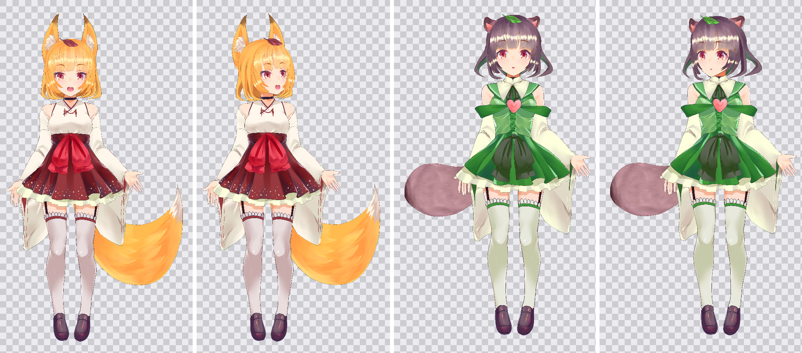

# Pad2D: Inochi2D for iPad

Pad2D makes and plays [Inochi2D](https://github.com/Inochi2D/inochi2d) puppets (`.inp` files and Inochi Creator `.inx` projects) natively on iPadOS. You can rig a model from a layered PSD on the iPad itself, then test it with face tracking. It renders with Metal and supports face tracking, physics and touch control. It's tuned for the iPad 10th generation (A14, 4 GB RAM).

Its runtime is a **Swift port of the Inochi2D 0.8 runtime**, the version Inochi Creator and Inochi Session use today. CI checks it against the original D code on every push (see [Verification](#verification)).



*Sample models Aka and Midori by seagetch (CC BY 4.0), rendered from Pad2D's draw list.*

> Pad2D is an independent, unofficial project and isn't affiliated with the Inochi2D Project. Inochi2D is © the Inochi2D Project, BSD 2-Clause licensed; see `Packages/Inochi2DKit/LICENSE`.

## Editor

Tap **Edit** on any model, or **New from PSD** in the library.

- **New from PSD:** every layer becomes a part, placed where it is in the PSD, with an auto-generated mesh. Folders become groups, or composites if they have a blend mode. Save the PSD as 8-bit RGB (PSB works too).
- **Model mode:**
  - Tap a part to select it, and use **Move** to drag it.
  - The inspector edits position, rotation, scale, z-sort, opacity, blend mode, tint, masks, mesh groups and physics.
  - Drag a number's label sideways to scrub its value.
- **Mesh mode:**
  - Tap to add vertices, drag them to move, or switch to Delete.
  - **Auto Mesh** wraps the part's opaque pixels.
  - Existing deformations are carried over to the new mesh.
- **Rigging:**
  - In **Parameters**, create a 1D or 2D parameter and press its record button to arm it.
  - At each keypoint, use the **Deform** brush (finger or Pencil) to push vertices, or change values in the inspector. Those are recorded as that keypoint's offsets.
  - Keypoints in between are filled in the same way Inochi Creator does it.
  - Red dots on the pad show the keypoints the selected part has recorded.
  - Add keypoint rows and columns from a parameter's ••• menu.
- **Physics:** add a Physics node under the part it hangs from, pick its parameter, and turn on the wind button to preview.
- **Undo/redo**, **Save**, **Play** (opens the model with tracking), and **Export** to Files as `.inx` (Inochi Creator) or `.inp` (Inochi Session).

Files saved by Pad2D load in the original Inochi2D 0.8.7 and behave the same (checked in CI).

## Features

- **Opens any Inochi2D 0.8 model:**
  - Part, Composite, MeshGroup (including dynamic deformation), SimplePhysics, AnimatedPart
  - Masks and dodge masks
  - Parameters with Nearest/Linear/Cubic interpolation
  - Sine automation
- **All 19 Inochi2D blend modes**, computed in the shader with framebuffer fetch. Overlay, Soft Light, Color Burn and the other "advanced" modes look the same as in Inochi Creator on a desktop GPU.
- **Face tracking** with the front camera through ARKit. It works on the iPad 10th gen even without Face ID hardware, and nothing leaves the device. Head turn, nod and tilt, eye blinks, gaze, mouth open and smile are mapped to the model's parameters automatically, and you can adjust or invert each mapping.
- **Follow finger mode:** the model looks wherever you touch.
- **Pendulum physics** for hair and clothes, plus idle breathing and blinking.
- **Parameter panel** with sliders and XY pads, and a presentation mode with green or blue screen backgrounds for screen recording.
- **Sample models** Aka and Midori by seagetch (CC BY 4.0) are bundled.

### Gestures

| Gesture | Action |
| --- | --- |
| Pinch | Zoom |
| Two-finger drag | Pan |
| One-finger drag | Pan, or steer the head in *Follow finger* mode |
| Double tap | Reset the view |

## Built for 4 GB iPads

- Textures are decoded one at a time into GPU-only (private) Metal textures with mipmaps, and CPU copies are freed straight away. If a model would need more than about 1/6 of RAM (~680 MB on a 4 GB iPad), all its textures are scaled down evenly and the app tells you.
- The model file is memory-mapped, so its pages can be dropped by the OS.
- Deformation runs on the CPU in about 1–2 ms per frame for the sample models. Geometry goes to the GPU through a ring of three reused buffers.
- Face tracking uses ARKit's smallest video format.

## Install on iPad without a computer

GitHub Actions builds the app on a Mac in the cloud on every push.

1. Open **Releases → Latest build** on this repo from your phone or iPad and download `Pad2D-unsigned.ipa`. It's also attached to each run under **Actions** as an artifact.
2. iPadOS only installs signed apps, so sign it with one of:
   - **SideStore** (free, uses your Apple ID, re-sign every 7 days). The first setup needs a computer once to create a pairing file.
   - **An Apple Developer account** ($99/year). The workflow can be extended to sign and upload to TestFlight, and then you install from the TestFlight app with no computer at all.
3. Put `.inp`/`.inx` models in the Files app, then use **Import** in Pad2D or *Share → Pad2D*.

## Project layout

```
Packages/Inochi2DKit/   Swift port of the Inochi2D 0.8 runtime (no UIKit/Metal; tested on Linux and macOS)
  INPFile.swift         .inp/.inx container reader
  Node.swift            Node, Drawable, Part, Composite
  MeshGroup.swift       Mesh group deformation of child meshes
  Parameter.swift       Parameters, value and deformation bindings
  SimplePhysics.swift   Pendulum and spring-pendulum physics (RK4)
  Puppet.swift          Update loop, draw order, sine automation
  DrawList.swift        Renderer-agnostic draw commands
  Tracking.swift        Tracking-to-parameter mapping
  TGA.swift             Texture decoder for Inochi Creator's TGA textures
  Writer.swift          Saving .inp/.inx
  Editing.swift         Editing operations (nodes, meshes, parameters, bindings)
  Reinterpolate.swift   Inochi Creator's keypoint fill-in
  PSD.swift             PSD reader and importer
  MeshGenerator.swift   Auto-mesh and Delaunay triangulation
App/Sources/            iPad app (SwiftUI + Metal + ARKit); the editor is in App/Sources/Editor
Tools/Verify/           Compares the port with the original Inochi2D 0.8.7
project.yml             XcodeGen project definition
```

## Verification

`Tools/Verify/run.sh` checks the port against the original Inochi2D 0.8.7 in two ways:

1. **Geometry.** It builds Inochi2D 0.8.7 (renderless) and compares every drawn vertex of both sample models, in draw order. That covers the rest pose, parameter poses (2D head, body roll, mouth, blink, breath) and up to 600 frames of physics. The port matches to within 0.01 px.
2. **Pixels.** It renders the models with Inochi2D's own OpenGL renderer (headless, on Mesa) and with a CPU renderer that follows the same rules as Pad2D's Metal shaders (draw list, masks, composites, blend modes, mipmaps). The average difference is under 1.5/255.

CI runs both on every push.

```sh
cd Packages/Inochi2DKit && swift test   # unit tests
Tools/Verify/run.sh                     # needs ldc2/dub, swift, python3, Mesa EGL
```

## Not yet supported

- Inochi2D 0.9 files (`TRNSRTS2`). 0.9 is still being rewritten upstream, and its current code can't animate models yet.
- Some of Inochi Creator's editing tools: mesh groups can't deform children through the brush yet, there's no automatic mirroring of deformations, and no animation timeline.
- Emission and bump maps (0.8 renders these to extra buffers for scene lighting).
- Animations stored in the model (the 0.8 animation player), and VMC/OpenSeeFace network tracking.
